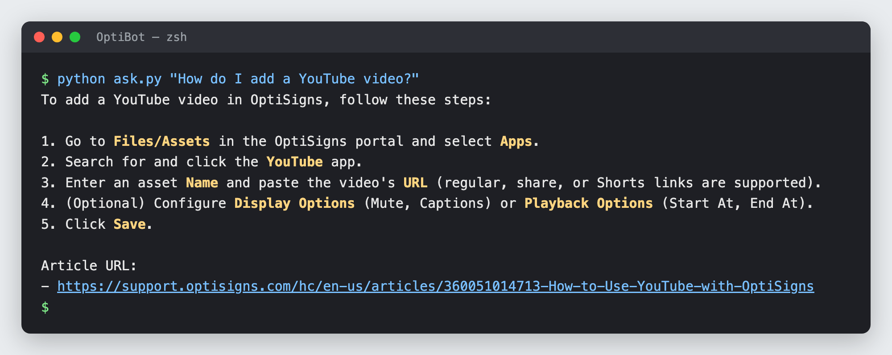

# OptiBot knowledge sync

Scrapes every published article from support.optisigns.com, converts it to clean Markdown and keeps a Google Gemini File Search store in sync with it, once a day. The store powers OptiBot, an assistant that answers only from these docs.

## Setup

Requires Python 3.10+. A free Gemini API key is available at aistudio.google.com/apikey.

```bash
python3 -m venv .venv && . .venv/bin/activate
pip install -r requirements-dev.txt
cp .env.sample .env        # set GEMINI_API_KEY
```

## Run locally

```bash
python main.py                                   # scrape -> articles/*.md -> sync File Search store
python ask.py "How do I add a YouTube video?"    # ask OptiBot from the terminal
pytest -q                                        # tests
```

With Docker (runs once, exits 0):

```bash
docker build -t optibot-sync .
docker run --rm -e API_KEY=your-gemini-key optibot-sync main.py
```

## How it works

1. **Scrape.** `zendesk_client.py` pages through the public Help Center API (`/api/v2/help_center/en-us/articles.json`), skipping drafts.
2. **Clean.** `markdown_converter.py` drops scripts, styles, inline base64 images and styling wrappers, turns video iframes into links, flattens layout tables (callouts, image grids) and keeps real data tables. It keeps headings, code blocks and ordered-list numbering. It also rewrites Zendesk TOC anchors to Markdown heading slugs, so in-page links still work. Relative links are kept as-is. Each file is saved as `articles/<id>-<slug>.md` and starts with `# Title` and an `Article URL:` line, which the bot cites.
3. **Detect the delta.** Each document in the File Search store carries `article_id` and a SHA-256 `content_hash` as custom metadata. Every run compares the fresh Markdown with that metadata. New articles are added. Changed ones are re-uploaded first, then the old document is deleted. Unchanged ones are skipped, and articles removed from the Help Center are deleted from the store. All state lives in the store, so the job is stateless and can run on any host. Deletes are guarded:
   - A partial scrape (`MAX_ARTICLES`) never deletes anything.
   - An article that fails to convert keeps its old copy.
   - A run that would remove more than 20% of the store stops unless `ALLOW_MASS_DELETE=1`.

   Any failure makes the job exit 1.
4. **Log.** Each run prints `added / updated / skipped / removed`, plus the number of files and chunks embedded, and writes `run_report.json`.

**Chunking: white-space, 400 tokens with 100 overlap.** With Gemini's `white_space_config` a token is a word, so 400 words is roughly 500-550 model tokens. Help articles are short, step-by-step pages with one task per H2 section. Windows of this size usually hold one section, so retrieval returns the steps for the question asked instead of a whole page. The 100-word overlap keeps a numbered step attached to its heading when a section spans two chunks. The API does not report chunk counts, so `chunk_estimator.py` reproduces the same word window to log them.

## Daily job

`.github/workflows/daily-sync.yml` builds the Dockerfile and runs it at 02:00 UTC every day on GitHub Actions. Each run shows its counts in the job summary and uploads the Markdown, `job.log` and `run_report.json` as a run artefact.
It needs the repository secret `GEMINI_API_KEY` and, optionally, the variable `FILE_SEARCH_STORE_NAME`.

- Job logs: <!-- TODO: link to the Actions run -->

## Assistant

OptiBot uses the required system prompt with the File Search tool over this store.


